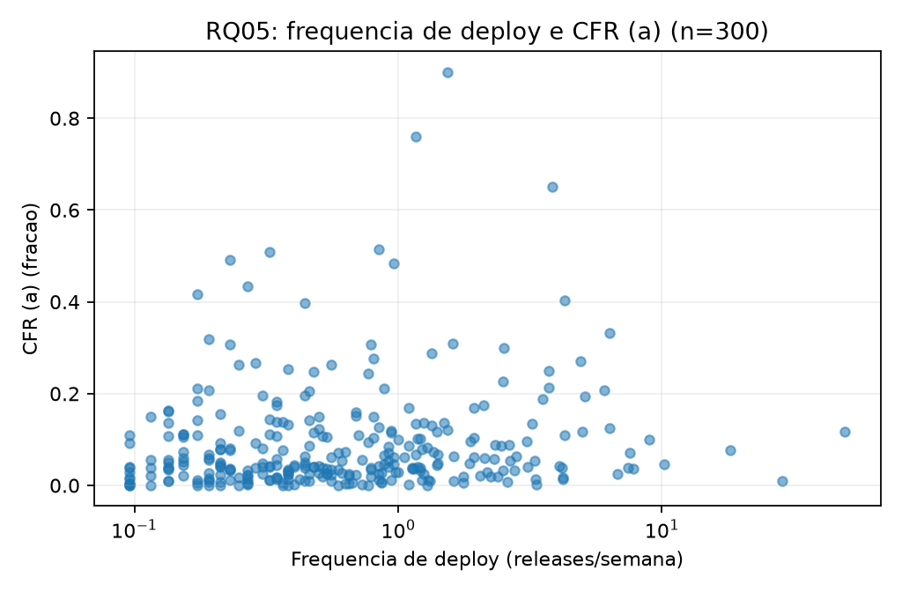
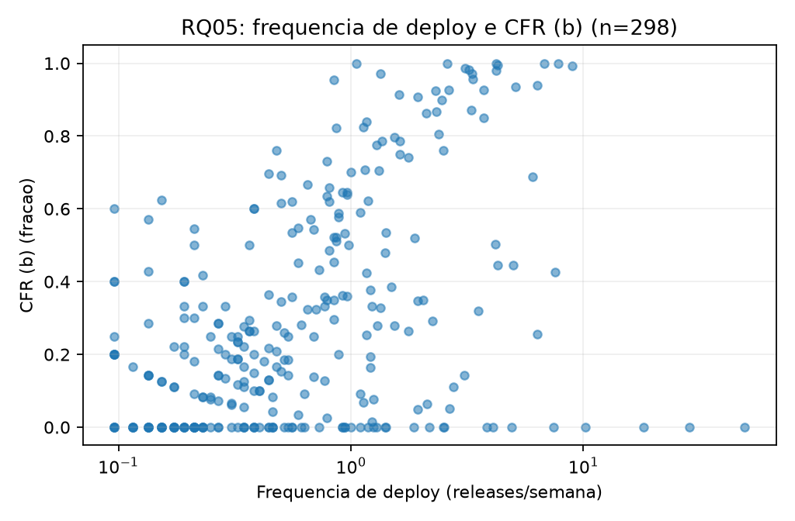

# Resultados reexecutáveis — Lab03 Sprint 3

Os resultados abaixo vêm dos 300 repositórios em `labs/lab03_dora/data/dataset.csv`
(janela de 01/10/2025 a 30/09/2026). Reproduza tabelas e figuras, sem token ou nova coleta, com:

```bash
python -m labs.lab03_dora.analises_s03
```

Os CSVs completos ficam em `labs/lab03_dora/data/analise_s03/`. Os quartis usam
interpolação linear; IQR = Q3 − Q1. Valores ausentes saem do cálculo da respectiva
métrica, e cada tabela informa seu `n`.

## RQ 01 a 04 — descrição e classificação C1 (#75)

| Métrica | n | Mediana | Q1 | Q3 | IQR |
| --- | ---: | ---: | ---: | ---: | ---: |
| Frequência de deploy (releases/semana) | 300 | 0,537 | 0,249 | 1,227 | 0,978 |
| Lead time (a), por release (h) | 299 | 252,70 | 72,42 | 941,06 | 868,63 |
| Lead time (b), por commit (h) | 299 | 267,33 | 74,95 | 1.179,18 | 1.104,23 |
| CFR (a), falhas de CI | 300 | 4,78% | 2,32% | 11,29% | 8,97 p.p. |
| CFR (b), release corretiva | 298 | 36,36% | 14,46% | 65,60% | 51,14 p.p. |
| Recuperação (h) | 283 | 2,56 | 0,97 | 6,28 | 5,31 |

Na combinação de referência C1 (release, lead time (a), CFR (a)), a distribuição é:

| Classificação | Low | Medium | High | Elite | Indisponível |
| --- | ---: | ---: | ---: | ---: | ---: |
| Frequência | 65 | 144 | 83 | 8 | 0 |
| Lead time (a) | 87 | 90 | 76 | 46 | 1 |
| CFR (a) | 7 | 10 | 34 | 249 | 0 |
| Recuperação | 2 | 24 | 183 | 74 | 17 |
| Geral C1 | 14 | 130 | 132 | 24 | 0 |

Na RQ 03(b), 649 de 22.130 releases únicas (2,93%) foram censuradas por estarem nos
últimos sete dias da janela. Na RQ 04, 172 de 64.210 episódios (0,27%) ficaram sem
sucesso posterior observado. Os denominadores são totais de casos, não médias das
proporções por repositório.

## RQ 05 e 06 — correlação e subgrupos (#76)

Spearman entre frequência de deploy e CFR (pares completos):

| CFR | n | rho | p |
| --- | ---: | ---: | ---: |
| (a), falhas de CI | 300 | 0,159 | 0,00588 |
| (b), release corretiva | 298 | 0,715 | 5,09 × 10⁻⁴⁸ |





As duas associações são positivas, mas têm magnitudes diferentes. A correlação não
estabelece causalidade nem demonstra um trade-off entre velocidade e estabilidade;
os dois CFRs medem fenômenos diferentes.

Para RQ 06, linguagem foi agrupada nas cinco mais frequentes (TypeScript, Python, Go,
Rust e JavaScript) e `Outras`; estrelas e contribuidores foram divididos em quartis.
Tipo de projeto usa somente os 60 itens do consenso da amostra-ouro. Foram feitos 16
testes Kruskal-Wallis (4 fatores × 4 métricas de C1), com correção de Holm conjunta.
O tamanho de efeito é `H/(n−1)`; comparações par a par usam Mann-Whitney, Holm dentro
de cada fator/métrica e Cliff’s delta interpretado pelos limiares de Romano et al.

Depois da correção, há diferenças no lead time (a) por linguagem
(`p_Holm = 0,000568`, `epsilon² = 0,094`) e por quartil de contribuidores
(`p_Holm = 6,11 × 10⁻¹¹`, `epsilon² = 0,189`). Entre os pares significativos, o
quartil superior de contribuidores tem lead time (a) maior que Q1, Q2 e Q3. Não houve
resultado significativo para tipo de projeto; nessa comparação, o `n` é 60 (57 para
recuperação). O CSV `subgrupos_pares.csv` conserva `n`, valores de `p` ajustados e
Cliff’s delta de todos os pares, inclusive os não significativos.

## RQ 07 e bônus RQ 08 — sensibilidade (#77)

C1 usa release/lead time (a)/CFR (a); C2 usa release com pre-release/lead time (b)/CFR
(b); C3 usa tag/lead time (b)/CFR (a). A recuperação e os cortes DORA ficam iguais
nos três cenários. C1 foi recalculada para cada repositório e conferida com todas as
notas e a categoria do dataset antes de gerar as saídas.

| Par | n | Mudaram de categoria | % | Kappa ponderado linear |
| --- | ---: | ---: | ---: | ---: |
| C1 × C2 | 300 | 114 | 38,00% | 0,408 |
| C1 × C3 | 300 | 61 | 20,33% | 0,706 |
| C2 × C3 | 300 | 117 | 39,00% | 0,435 |

As distribuições gerais são C1: 14 Low, 130 Medium, 132 High e 24 Elite; C2: 20,
188, 89 e 3; C3: 9, 108, 160 e 23, respectivamente. Entre C1 e C2, 10,67% mudam
de faixa de frequência, 41,14% de lead time e 72,82% de CFR, entre os pares com
as duas notas disponíveis. A nota de recuperação não muda por definição.

Assim, as conclusões de RQ 01 a 03 dependem da definição operacional, sobretudo a de
falha. A RQ 04 é estável entre cenários porque sua métrica foi mantida. A direção
positiva da associação em RQ 05 permanece, mas `rho` muda de 0,159 para 0,715 conforme
o CFR. Para RQ 06, a associação entre quartis de contribuidores e a nota DORA geral
é significativa em C1 (`p_Holm = 0,028`), mas não em C2/C3; a associação com linguagem
surge em C3 (`p_Holm = 0,011`). Portanto, nem a inferência por subgrupos é estável.

No bônus RQ 08, *rework rate* = releases marcadas corretivas / releases principais
únicas do repositório, inclusive as censuradas para CFR (b). A mediana entre os 300
repositórios é 72,0% (Q1 41,0%; Q3 90,2%). No conjunto há 12.242 releases marcadas
corretivas entre 22.130 releases únicas. Esta taxa é um proxy baseado na heurística,
não uma contagem observada de defeitos em produção.

## Limitações que acompanham os resultados

- A heurística de release corretiva final é `semver-patch-commits-fix-v2` (patch do SemVer ou pelo menos
  1/3 dos commits com fix/revert/hotfix), com F1 de **0,823** contra o consenso (precisão 0,909, recall
  0,752). A primeira versão, `semver-patch-v1`, tinha F1 0,670; todas as versões testadas estão em
  `labs/lab03_dora/amostra_ouro/heuristicas_f1.csv`. CFR (b), C2 e rework rate acima usam a v2.
- Com 79% de releases corretivas no consenso, "marcar tudo" já atinge F1 0,885; por isso a escolha da v2
  considerou também a precisão e o F1 contra cada avaliador individualmente (pior caso 0,719).
- A rotulagem de João teve assistência de IA, conforme `validacao_amostra_ouro.md`. A concordância entre
  avaliadores não representa três rotulagens plenamente independentes.
- As 28 releases repetidas de `releases.csv` (paginação durante a coleta) foram removidas e os CSVs foram
  regenerados a partir do cache, sem nova coleta; o dataset e as análises acima já refletem a correção.
- O artigo consolidado, com discussão e ameaças à validade, está em `docs/lab03/artigo.tex`.
