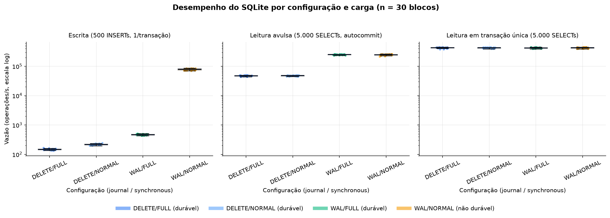
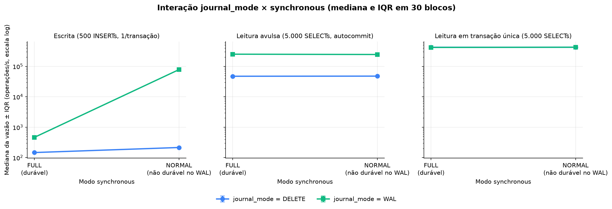
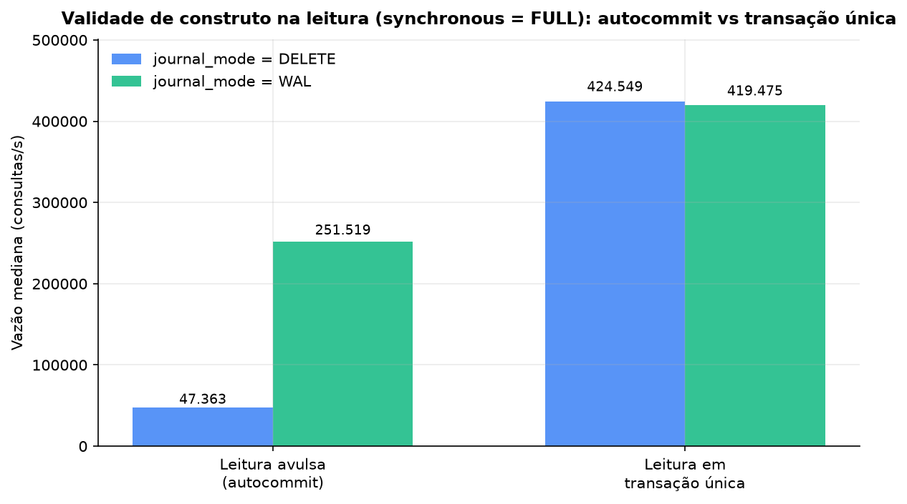
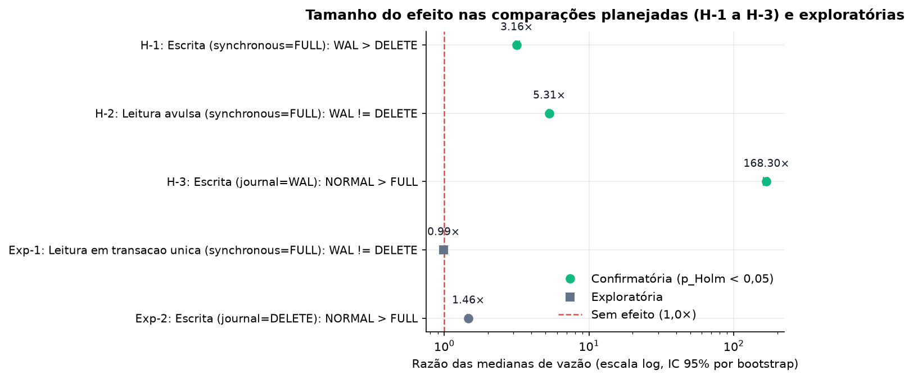

# Lab05 — Resultados da análise estatística (#122)

> Gerado de forma reprodutível a partir de [`labs/lab05_sqlite/data/raw/coleta_completa.csv`](../../labs/lab05_sqlite/data/raw/coleta_completa.csv) (30 blocos × 3 cargas × 4 configurações = 360 medições) por [`labs/lab05_sqlite/analise.py`](../../labs/lab05_sqlite/analise.py) e [`labs/lab05_sqlite/graficos.py`](../../labs/lab05_sqlite/graficos.py).

## 1. Estatística descritiva e durabilidade (M1, M4, M6, M7)

Como as vazões variam em ordens de grandeza e apresentam assimetria, reportamos **mediana**, **IQR** (Q3 − Q1), extremos e **coeficiente de variação (M7)**, acompanhados da **durabilidade nominal (M6)** segundo a documentação oficial do SQLite.

| Carga | Configuração | Mediana (op/s) | IQR (op/s) | Mín – Máx (op/s) | CV (M7) | Durabilidade (M6) |
| --- | --- | ---: | ---: | --- | ---: | --- |
| Escrita | `DELETE/FULL` | 147,35 | 7,83 | 134,17 – 165,15 | 0,048 | Durável |
| Escrita | `DELETE/NORMAL` | 215,83 | 11,88 | 195,46 – 242,49 | 0,049 | Durável (risco mínimo antes do commit) |
| Escrita | `WAL/FULL` | 465,76 | 30,73 | 427,21 – 509,43 | 0,048 | Durável |
| Escrita | `WAL/NORMAL` | 78.386,58 | 7.878,01 | 69.043,61 – 85.223,88 | 0,061 | Não durável após queda de energia |
| Leitura avulsa | `DELETE/FULL` | 47.363,18 | 2.313,50 | 43.025,89 – 49.346,26 | 0,036 | Durável |
| Leitura avulsa | `DELETE/NORMAL` | 47.814,58 | 2.362,67 | 44.376,09 – 48.884,89 | 0,031 | Durável |
| Leitura avulsa | `WAL/FULL` | 251.518,56 | 8.415,21 | 229.319,93 – 257.294,30 | 0,030 | Durável |
| Leitura avulsa | `WAL/NORMAL` | 245.687,31 | 11.702,86 | 212.330,45 – 260.575,46 | 0,047 | Não durável após queda de energia |
| Leitura (1 transação) | `DELETE/FULL` | 424.549,02 | 17.145,70 | 375.423,29 – 444.563,01 | 0,040 | Durável |
| Leitura (1 transação) | `DELETE/NORMAL` | 425.551,86 | 22.127,88 | 387.287,66 – 438.673,46 | 0,035 | Durável |
| Leitura (1 transação) | `WAL/FULL` | 419.475,46 | 21.692,59 | 387.789,29 – 447.759,85 | 0,039 | Durável |
| Leitura (1 transação) | `WAL/NORMAL` | 425.854,60 | 28.912,45 | 387.825,39 – 448.760,53 | 0,044 | Não durável após queda de energia |

## 2. Testes de hipótese, tamanho do efeito e análise de sensibilidade

Aplicamos o **teste de Wilcoxon pareado por bloco** (n = 30) com **correção de Holm** para as três hipóteses confirmatórias (α = 0,05), **razão das medianas** com IC 95% via *bootstrap* (10.000 reamostragens), **correlação rank-bisserial** e **teste t pareado** como análise de sensibilidade.

| Código | Comparação | Razão das medianas (IC 95%) | p (Wilcoxon) | p (Holm) | Rejeita H₀? | Rank-bisserial | p (t pareado) |
| --- | --- | ---: | ---: | ---: | :---: | ---: | ---: |
| **H-1** | Escrita (`WAL/FULL` > `DELETE/FULL`) | **3,16×** [3,11; 3,29] | 9,31 × 10⁻¹⁰ | **2,79 × 10⁻⁹** | Sim | +1,000 | 1,75 × 10⁻³⁶ |
| **H-2** | Leitura avulsa (`WAL/FULL` ≠ `DELETE/FULL`) | **5,31×** [5,20; 5,36] | 1,86 × 10⁻⁹ | **2,79 × 10⁻⁹** | Sim | +1,000 | 5,62 × 10⁻⁴⁴ |
| **H-3** | Escrita (`WAL/NORMAL` > `WAL/FULL`) | **168,30×** [160,83; 172,38] | 9,31 × 10⁻¹⁰ | **2,79 × 10⁻⁹** | Sim | +1,000 | 2,80 × 10⁻³⁷ |
| *Exp-1* | Leitura 1 transação (`WAL/FULL` ≠ `DELETE/FULL`) | **0,99×** [0,97; 1,02] | 0,626 | — | Não | −0,105 | 0,725 |
| *Exp-2* | Escrita (`DELETE/NORMAL` > `DELETE/FULL`) | **1,46×** [1,44; 1,50] | 9,31 × 10⁻¹⁰ | — | Sim | +1,000 | 1,12 × 10⁻²⁸ |

- **Interação `journal_mode × synchronous`:** na escrita, `NORMAL` acelera `DELETE` em apenas **1,46×**, mas acelera `WAL` em **168,30×** (porque dispensa `fsync` a cada *commit* no WAL, ao custo da durabilidade em queda de energia). Na leitura, `synchronous` praticamente não altera a vazão.
- **Validade de construto na leitura (H-2 vs Exp-1):** em consultas avulsas (*autocommit*), o WAL é **5,31×** mais rápido porque evita travar/destravar o arquivo a cada `SELECT`. Quando todas as 5.000 leituras ocorrem numa única transação, o WAL fica **1,20% mais lento** (0,988×, sem significância estatística), confirmando os "1–2% mais lento" da documentação oficial.
- **Valores atípicos (regra 3 × IQR):** 0 atípicos em `ops_por_s`; 13 ocorrências isoladas em `latencia_mediana_ms` e `latencia_p95_ms` (4 em escrita, 9 em leitura avulsa), mantidas na análise principal.
- **Poder estatístico (simulação a partir do piloto, n = 30):** erro tipo I simulado entre 4,4% e 5,0%, e poder simulado de **100%** para H-1, H-2 e H-3.

