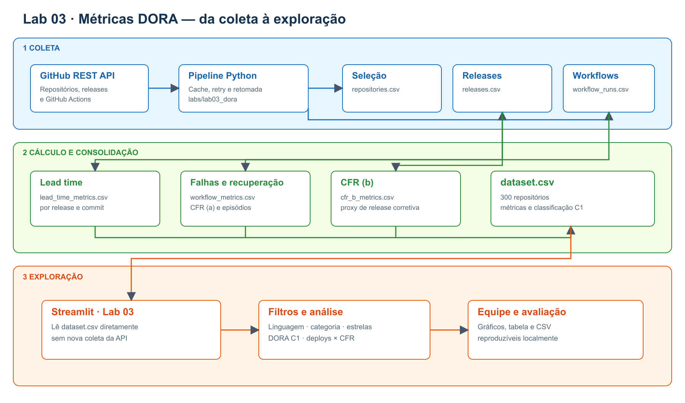
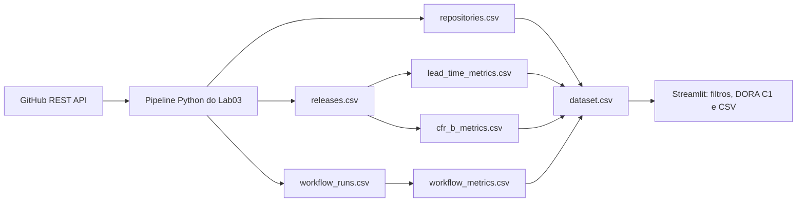
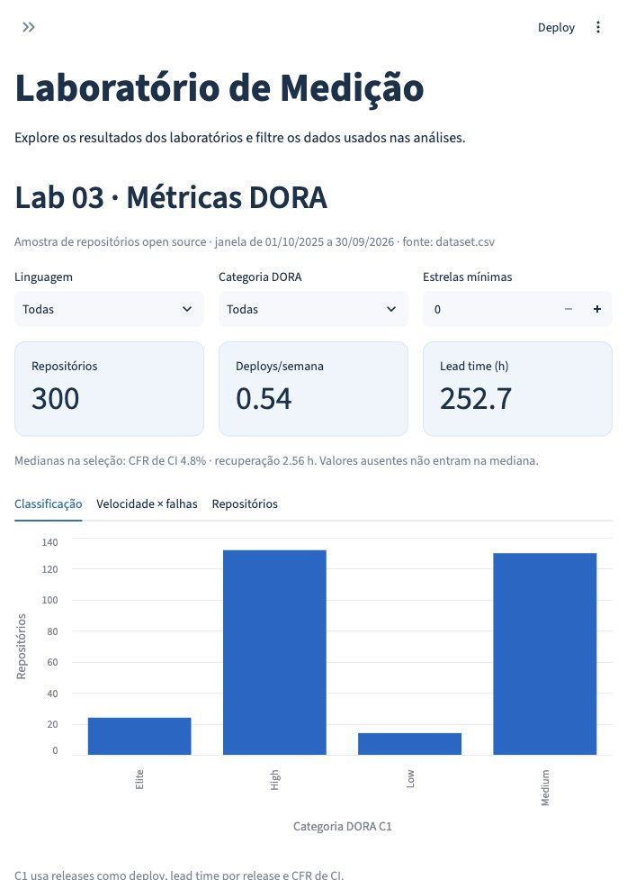

# Lab03 - Mineracao de metricas DORA

Calcula as metricas DORA (deployment frequency, lead time for changes, change failure rate e tempo de
recuperacao) a partir dos dados publicos de repositorios open-source que usam GitHub Actions.

## Diagrama do Lab03



[Abrir a imagem em tamanho completo](../../docs/lab03/lab03_pipeline_architecture.png) ·
[Abrir o SVG](../../docs/lab03/lab03_pipeline_architecture.svg)

O desenho mostra o fluxo real do Lab03: coleta da API do GitHub, calculo das metricas, geracao
de `data/dataset.csv` e exploracao no Streamlit. O app le o CSV consolidado sem chamar a API.



### Captura da interface Streamlit



[Abrir a captura em tamanho completo](../../docs/lab03/streamlit_dashboard_lab03.jpg).

Todos os comandos rodam a partir da raiz do repositorio, com o ambiente da raiz instalado
(`pip install -r requirements.txt`, ver README raiz).

## Como reproduzir

1. Defina o token do GitHub (nunca commite o token):

   ```bash
   export GITHUB_TOKEN=ghp_...        # ou GITHUB_TOKEN=... no arquivo .env da raiz
   ```

2. Confira a janela de observacao em [`config.yaml`](config.yaml). O padrao sao os 12 meses completos
   antes do inicio do Lab03 (2025-10-01 a 2026-09-30); se o professor fixar outras datas, troque ali.
   Com a janela vazia ou fora de 12 meses, o pipeline se recusa a rodar.

3. Rode o pipeline com um unico comando:

   ```bash
   python -m labs.lab03_dora --config labs/lab03_dora/config.yaml
   ```

   Para rodar so uma etapa: `--etapa selecao`, `--etapa releases` ou `--etapa workflow_runs`.
   As duas ultimas etapas leem `saida.dados/repositories.csv`, produzido pela selecao.

A coleta pode ser interrompida a qualquer momento (rate limit, queda de rede, `Ctrl+C`): rodar o mesmo
comando de novo continua de onde parou, sem repetir chamadas ja feitas.

### Saida da selecao (#60)

`python3 -m labs.lab03_dora --etapa selecao` grava tres CSVs em `saida.dados`:

| Arquivo | Colunas | Origem e significado |
| --- | --- | --- |
| `repositories.csv` | `repository`, `stars`, `language`, `contributors`, `created_at`, `age_days`, `default_branch`, `published_releases`, `valid_workflow_runs` | Uma linha por repositorio incluido. Estrelas, linguagem, criacao e branch vem da busca; contribuidores incluem anonimos, contados pela ultima pagina da API (vazio quando a API recusa a contagem por a lista ser grande demais); idade e dias entre criacao e fim da janela. As duas contagens se referem a janela configurada. |
| `selection_decisions.csv` | `repository`, `decision`, `reason`, `stars`, `releases`, `valid_workflow_runs` | Uma linha por candidato examinado, na ordem de busca; campos de contagem ficam vazios quando o candidato e descartado antes daquela consulta. |
| `selection_funnel.csv` | `stage`, `remaining`, `excluded` | Contagem dos candidatos examinados e de cada descarte (`no_actions`, `insufficient_releases`, `insufficient_workflow_runs`, `repository_unavailable`). A ultima linha mostra a amostra incluida. `repository_unavailable` cobre repositorios removidos (404), bloqueados (403/451) ou vazios (409), em qualquer etapa da inspecao. |

A busca percorre faixas de estrelas acima de 1.000, das maiores para as menores, dividindo automaticamente
qualquer faixa com mais de 1.000 resultados. Ela para ao atingir `amostra.repositorios`. Assim, o funil
descreve **os candidatos examinados**, nao todos os repositorios do GitHub com mais de 1.000 estrelas.
Releases de rascunho e pre-releases nao contam na definicao principal; as pre-releases ficam para a
analise de sensibilidade posterior. Runs contam apenas quando sao `push` no branch padrao, com conclusao
`success`, `failure`, `timed_out` ou `startup_failure`. A coleta divide meses com 1.000 ou mais runs em
intervalos menores para evitar a perda de resultados da API. As colunas `published_releases` e
`valid_workflow_runs` sao contagens limitadas aos minimos configurados (5 e 50 por padrao): para um
repositorio incluido, esses valores significam **pelo menos** 5 e **pelo menos** 50. As contagens completas
serao produzidas pelas etapas de releases (#61) e workflow runs (#62).

### Saida de releases e lead time (#61)

| Arquivo | Conteudo |
| --- | --- |
| `releases.csv` | Uma linha por release principal publicada na janela; inclui tag anterior, resultado do compare, `compare_api_status` (`ahead`, `diverged`...), commits examinados, commits com lead time negativo e lead time por release em horas. A release anterior pode estar fora da janela. |
| `release_commits.csv` | Um commit por linha, com `commit.author.date` e lead time individual em horas. |
| `pre_releases.csv` | Pre-releases publicadas na janela, separadas da definicao principal para a RQ 07. |
| `tags.csv` | Tags cujos commits apontados tem `commit.author.date` na janela, com nome, SHA e data; `not_a_commit` registra tags que apontam para outro tipo de objeto. Coletadas via GraphQL, 100 por chamada e ordenadas pela data do commit, parando ao sair da janela. |
| `lead_time_metrics.csv` | Por repositorio: contagens, compares 404, releases `diverged`, commits com lead time negativo e medianas `lead_time_a_hours` (por release) e `lead_time_b_hours` (por commit). Valor vazio significa que nao houve observacao calculavel. |

A primeira release da historia nao tem base de comparacao. Um compare 404 e registrado e a release sai das
medianas. Releases sem commits novos tambem nao entram nas medianas. Datas negativas de lead time, se
aparecerem por rebase ou datas inconsistentes, permanecem no CSV e sao contadas para auditoria.

A release anterior e a publicada imediatamente antes por data, como no enunciado. Quando ela nao e
ancestral de R, o compare devolve `diverged`. Isso e comum em projetos que lancam a partir de branches de
release (ex.: `vscode` 1.105.0 sai de `release/1.105`, que nao contem `release/1.104`): na coleta da S02,
15% das releases e 155 dos 300 repositorios. O compare `anterior...R` usa o ancestral comum, entao conta os
commits que entraram em R desde que as duas linhas se separaram. Esses casos ficam contados em
`releases_diverged` para a secao de ameacas a validade.

Em compares muito grandes, a paginacao da API pode devolver alguns commits a menos que o
`total_commits` informado (ex.: 5.992 de 5.995). A release continua no calculo e a diferenca fica em
`commits_missing_from_compare` e `releases_incomplete_compare`.

### Saida de workflow runs, CFR e recuperacao (#62)

| Arquivo | Conteudo |
| --- | --- |
| `workflow_runs.csv` | Runs `push` no default branch criados na janela, inclusive conclusoes ignoradas, identificadas pela coluna `classification`. |
| `workflow_run_months.csv` | Auditoria por mes: `api_total_count`, `hit_cap` e quantidade coletada. Meses com 1.000 ou mais resultados sao subdivididos em dias e, se um dia ainda passar do teto, em faixas de horario (`created=AAAA-MM-DDTHH:MM:SSZ..`), ate que a coleta seja completa. |
| `recovery_episodes.csv` | Episodios por workflow, com primeira falha, sucesso de recuperacao, duracao em horas ou `censored=true`. |
| `workflow_metrics.csv` | Por repositorio: sucessos, falhas, ignorados, `cfr_a`, mediana de recuperacao em horas, proporcao de episodios censurados e primeiro/ultimo run observados. Valor vazio indica denominador zero. |

O CFR usa todos os workflows juntos; o tempo de recuperacao nunca atravessa workflows diferentes. Um
episodio so comeca na primeira falha apos um sucesso observado. A API do GitHub pode reter runs por menos
tempo que a janela de 12 meses; meses sem resultados no CSV de auditoria precisam ser interpretados junto
da politica de retencao do repositorio.

### Dados da coleta versionados (S02)

Os CSVs da coleta da S02 (janela 2025-10-01 a 2026-09-30, 300 repositorios) estao em `data/`. Dois arquivos
brutos ficam fora do Git por tamanho e sao regenerados pelo pipeline: `release_commits.csv` (~440 MB, um
commit por linha) e `workflow_runs.csv` (~390 MB, um run por linha). Todas as metricas do `dataset.csv`
podem ser recalculadas a partir dos demais CSVs ou refazendo a coleta, que retoma do cache.

### Dataset final e classificacao DORA (#65, #66)

A etapa `dataset` junta `repositories.csv`, `lead_time_metrics.csv`, `workflow_metrics.csv` e, quando
existir, `cfr_b_metrics.csv` em `dataset.csv`, uma linha por repositorio. Ela calcula a deployment frequency
(releases na janela / semanas da janela) e a classificacao DORA de referencia (C1: release, lead time (a),
CFR (a)) com os cortes da secao 5 do enunciado. Cada coluna esta documentada no
[dicionario de dados](dicionario_de_dados.md).

Como ela le apenas CSVs, da para refazer o dataset sem token e sem API:

```bash
python -m labs.lab03_dora.consolidacao --config labs/lab03_dora/config.yaml
```

A etapa de CFR (b) (#72) grava `cfr_b_metrics.csv` com as colunas `repository`, `cfr_b`,
`releases_evaluated` e `releases_censored`.

### CFR (b) — heuristica de release corretiva (#72)

```bash
python -m labs.lab03_dora.cfr_b --config labs/lab03_dora/config.yaml
python -m labs.lab03_dora.consolidacao --config labs/lab03_dora/config.yaml
```

A versao final, `semver-patch-commits-fix-v2`, marca R como corretiva se:

1. a tag so muda o patch do SemVer em relacao a release anterior (`2.3.0 -> 2.3.1`); ou
2. pelo menos 1/3 dos commits entre a anterior e R tem `fix`, `bugfix`, `hotfix`, `revert` ou `regression`
   na primeira linha da mensagem (`fix_commits / commits_compared` em `releases.csv`).

R falha se uma release corretiva sai ate 7 dias depois; releases dos ultimos 7 dias da janela sao
censuradas. `cfr_b_releases.csv` registra classificacao, sinal, versao, falha e censura de cada release;
`cfr_b_metrics.csv` agrega por repositorio. O dataset pode ser reconstruido sem token.

Versoes avaliadas contra a amostra-ouro (`python -m labs.lab03_dora.avaliar_heuristicas`, resultado em
`amostra_ouro/heuristicas_f1.csv`):

| Versao | F1 (consenso) | F1 (pior avaliador) | Releases marcadas |
| --- | ---: | ---: | ---: |
| `semver-patch-v1` (so patch) | 0,670 | 0,566 | 138 de 300 |
| patch ou qualquer commit fix | 0,885 | 0,697 | 268 |
| patch ou >= 50% dos commits fix | 0,737 | 0,660 | 161 |
| **`semver-patch-commits-fix-v2`** (patch ou >= 1/3) | **0,823** | **0,719** | 197 |
| referencia: tudo corretiva | 0,885 | 0,661 | 300 |

A v1 tinha um sinal de texto que nunca era aplicado (o `releases.csv` nao tinha as mensagens). Como o
consenso marca 79% das releases como corretivas, "marcar tudo" ja chega a F1 0,885: um F1 alto contra esse
consenso nao basta. A v2 e a unica versao que passa de 0,70 contra o
consenso e contra cada avaliador individualmente (pior caso 0,719), mantendo precisao de 0,91 e marcando 66% das releases, e nao quase todas.

### Amostra-ouro (#67)

```bash
python -m labs.lab03_dora.amostra_ouro --config labs/lab03_dora/config.yaml
```

Sorteia 60 repositorios da amostra final (`repositories.sample(n=60, random_state=42)`) e, de cada um, ate 5
releases da janela (`random_state=42`). Grava em `labs/lab03_dora/amostra_ouro/`:

- `repositorios_sorteados.csv` e `releases_sorteadas.csv`: o sorteio, para auditoria;
- `rotulagem_pedro.xlsx`, `rotulagem_joao.xlsx`, `rotulagem_salomao.xlsx`: uma planilha por avaliador, com
  links para o repositorio, para a pagina da release e para os commits desde a release anterior, e listas
  de opcoes nas colunas de rotulo. Com `GITHUB_TOKEN` definido, a planilha tambem traz a descricao e os
  topicos de cada repositorio, as notas de cada release e a primeira linha dos commits desde a release
  anterior (respostas vindas do cache da coleta). As planilhas nao mostram a saida da heuristica.

O comando se recusa a sobrescrever planilhas existentes (para nao apagar rotulos), a menos que receba
`--forcar`. `amostra_ouro.read_labels(caminho)` le e valida uma planilha preenchida, para o calculo do
kappa (#71).

A rotulagem de Joao foi registrada em `amostra_ouro/rotulagem_joao.csv` e incorporada a
`rotulagem_joao.xlsx`. O CSV contem 420 decisoes: 60 tipos de projeto, 60 entregas reais
e 300 releases, com sugestao original, evidencia e proveniencia `humano_assistido_ia`.
Joao aprovou as sugestoes validas e decidiu `sim` para as 163 sugestoes `incerto` de
corretividade. Esta rotulagem nao e independente das sugestoes de IA; veja
`docs/lab03/validacao_amostra_ouro.md` antes de interpretar o kappa.

Para reaplicar o CSV auditavel na planilha, sem editar celulas manualmente:

```bash
python -m labs.lab03_dora.aplicar_rotulagem_joao
```

Quando as tres planilhas estiverem completas, calcular concordancia e consenso com:

```bash
python -m labs.lab03_dora.validacao_amostra_ouro \
  --predicoes labs/lab03_dora/data/cfr_b_releases.csv
```

O comando exige as tres planilhas completas, registra kappa de Fleiss por dimensao e gera
`desempates_pendentes.csv`. Desempates 1-1-1 precisam ser resolvidos no arquivo `desempates.csv`
(colunas `escopo,repositorio,tag,dimensao,rotulo,justificativa`) antes de gerar os CSVs de consenso
e o F1. `validacao_relatorio.json` guarda os resultados calculados. O metodo e as decisoes devem ser
descritos em `docs/lab03/validacao_amostra_ouro.md`.

## Para o grupo replicador

O pipeline roda com um unico comando e retoma de onde parou. Para replicar sobre uma subamostra de
30 repositorios do nosso `dataset.csv`, sem refazer a busca:

```bash
pip install -r requirements.txt
export GITHUB_TOKEN=ghp_...                         # token pessoal, so leitura publica
python -m labs.lab03_dora --config labs/lab03_dora/config.yaml \
  --repositorios labs/lab03_dora/replicacao/amostra_30.csv \
  --saida labs/lab03_dora/replicacao/execucao
python -m labs.lab03_dora.comparar_datasets \
  --original labs/lab03_dora/data/dataset.csv \
  --replicado labs/lab03_dora/replicacao/execucao/dataset.csv
```

- `replicacao/amostra_30.csv` e um sorteio fixo (`random_state=42`) de 30 repositorios do dataset; qualquer
  CSV com a coluna `repository` serve.
- `--saida` grava CSVs e cache numa pasta separada, sem sobrescrever os dados do grupo.
- Os repositorios da lista passam pelos mesmos criterios de inclusao; os que nao passarem mais aparecem
  em `selection_decisions.csv`.
- Custo esperado: os 30 repositorios do sorteio fixo exigiram cerca de 8.700 requisicoes na nossa coleta.
  Com a cota de 5.000 por hora, sao cerca de 2 horas; quando a cota acaba, o pipeline espera sozinho e
  continua. Para testar antes, use um CSV com 2 ou 3 repositorios.
- `comparar_datasets` mostra a diferenca relativa por metrica e a % de repositorios com a mesma classe
  DORA. Diferencas pequenas sao esperadas: os repositorios continuam recebendo releases e runs, e
  estrelas e contribuidores mudam com a data da coleta.

## Configuracao

| Chave | Significado | Padrao |
| --- | --- | --- |
| `janela.inicio`, `janela.fim` | Janela de observacao de 12 meses (AAAA-MM-DD). Obrigatoria. | - |
| `inclusao.min_releases` | Releases publicadas (`draft = false`) na janela | 5 |
| `inclusao.min_workflow_runs` | Workflow runs validos (`event = push` no default branch) na janela | 50 |
| `amostra.repositorios` | Tamanho alvo da amostra (a S02 exige no minimo 300 apos os filtros) | 300 |
| `saida.dados` | Pasta dos CSVs (metricas e funil) | `data` |
| `saida.cache` | Pasta do cache da API (gitignored) | `data/cache` |
| `api.max_tentativas` | Novas tentativas em erro 5xx ou de rede | 5 |
| `api.timeout_segundos` | Timeout de cada requisicao | 30 |
| `api.requisicoes_paralelas` | Repositorios processados ao mesmo tempo nas etapas `releases` e `workflow_runs` (a coleta e limitada pela latencia, nao pela cota); `1` volta ao modo sequencial | 4 |

Caminhos relativos sao resolvidos a partir da pasta do `config.yaml`.

## Etapas do pipeline

O pipeline roda as etapas em ordem. Cada etapa e uma funcao `run(ctx)` registrada em
[`pipeline.py`](pipeline.py) (`STAGES`).

| Etapa | Modulo | Issue |
| --- | --- | --- |
| `selecao` | `labs/lab03_dora/selecao.py` | #60 (componente A) |
| `releases` | `labs/lab03_dora/releases.py` | #61 (componente B) |
| `workflow_runs` | `labs/lab03_dora/workflow_runs.py` | #62 (componente C) |
| `cfr_b` | `labs/lab03_dora/cfr_b.py` | #72 |
| `dataset` | `labs/lab03_dora/consolidacao.py` | #66 |

Contrato de uma etapa:

```python
from labs.lab03_dora.pipeline import Context

def run(ctx: Context) -> None:
    config = ctx.config          # janela, criterios de inclusao, pastas de saida
    client = ctx.client          # GitHubRestClient, com cache, rate limit e backoff
    ...                          # le e grava CSVs em config.output_dir
```

As funcoes de calculo das metricas ficam em `labs/lab03_dora/metricas/`, separadas da coleta, para
serem testadas com *fixtures* sem acessar a API.

### Cliente da API (`shared/github_rest.py`)

```python
response = client.get("/repos/{owner}/{repo}")                          # Response(status, data, headers)
for release in client.paginate("/repos/{owner}/{repo}/releases"):       # segue Link: rel="next"
    ...
for run in client.paginate(f"/repos/{repo}/actions/runs", {"event": "push"}, item_key="workflow_runs"):
    ...
client.rate_limit()                                                      # nao consome cota, nunca cacheado
```

- **Cache e retomada:** cada resposta e salva em `saida.cache/<repos>/<owner>/<repo>/<endpoint>/`, um JSON
  por requisicao. Uma requisicao ja feita e respondida do disco, sem chamar a API. O token nunca e gravado.
  Paginas grandes sao enxugadas antes de gravar (`slim`): do `compare` ficam status, total e, de cada commit,
  SHA, data e mensagem (sem os diffs); dos workflow runs e das releases, so os campos que as etapas leem.
- **Rate limit:** le `X-RateLimit-Remaining`/`X-RateLimit-Reset` e pausa ate a renovacao quando a cota
  acaba; respeita `Retry-After` em rate limit secundario.
- **Erros temporarios:** respostas 5xx e erros de rede sao repetidos com backoff exponencial
  (1 s, 2 s, 4 s, 8 s, 16 s) ate `api.max_tentativas`.
- **404/410** (ex.: `compare` com tag apagada) levantam `GitHubNotFoundError` e tambem ficam no cache, para
  a retomada nao repetir a chamada. Outros erros 4xx levantam `GitHubAPIError` e nao sao cacheados.
- **GraphQL:** `client.graphql(query, variables, cache_key)` usa o mesmo cache e o mesmo tratamento de
  erros, e consome a cota do GraphQL, separada da cota REST. E usado nas tags.
- A coleta usa a API REST e GraphQL, implementadas com a biblioteca padrao (sem PyGithub ou equivalentes,
  proibidos pelo enunciado).

## Analises da Sprint 3 (#75, #76 e #77)

```bash
python -m labs.lab03_dora.analises_s03
```

O comando le `data/dataset.csv`, `amostra_ouro/consenso_repositorios.csv` e
`data/cfr_b_releases.csv`; nao usa token, nao chama a API e nao modifica esses arquivos.
Os 13 CSVs de resultado ficam em `data/analise_s03/` e os dois graficos de dispersao
em `docs/lab03/assets/`. `--dataset`, `--consenso`, `--releases`, `--saida` e
`--figuras` permitem escolher outros caminhos. Consulte
[`docs/lab03/resultados_s03.md`](../../docs/lab03/resultados_s03.md) para os resultados,
as definicoes estatisticas e as limitacoes.

As descritivas usam mediana, Q1, Q3 e IQR (quantis com interpolacao linear). Para
RQ 03(b), a proporcao censurada usa as releases unicas do CSV auditavel; para RQ 04,
usa os episodios de recuperacao. C1, C2 e C3 aplicam os mesmos cortes DORA de
`metricas/dora.py`, mantendo a recuperacao constante. O comando verifica que C1
coincide com as cinco notas e a categoria ja gravadas no dataset antes de gerar saidas.

Na RQ 06, linguagem usa as cinco mais frequentes e `Outras`; estrelas e contribuidores
usam quartis. O tipo de projeto vem do consenso dos 60 repositorios da amostra-ouro.
Holm corrige os 16 testes globais em conjunto e, separadamente, as comparacoes de
pares dentro de cada combinacao de fator e metrica. O bonus RQ 08 usa releases
corretivas / releases principais unicas por repositorio, inclusive as censuradas
para CFR (b): a censura se refere a observacao da falha posterior, nao ao tipo da release.

## Testes e CI

```bash
python -m pytest tests/lab03 --cov=labs/lab03_dora --cov=shared.github_rest --cov-report=term-missing
```

O workflow [`.github/workflows/testes.yml`](../../.github/workflows/testes.yml) roda a suite inteira do
repositorio (`tests/`) a cada push e pull request e falha se:

- algum teste falhar;
- a cobertura do Lab03 e do cliente da API ficar abaixo de 80%; ou
- a cobertura do modulo `labs/lab03_dora/metricas/` ficar abaixo de 80% (exigencia do enunciado).

Toda funcao nova em `metricas/` precisa vir com testes no mesmo PR, ou o CI fica vermelho.
